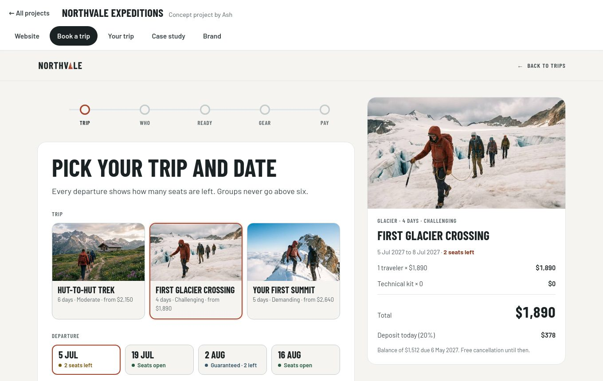
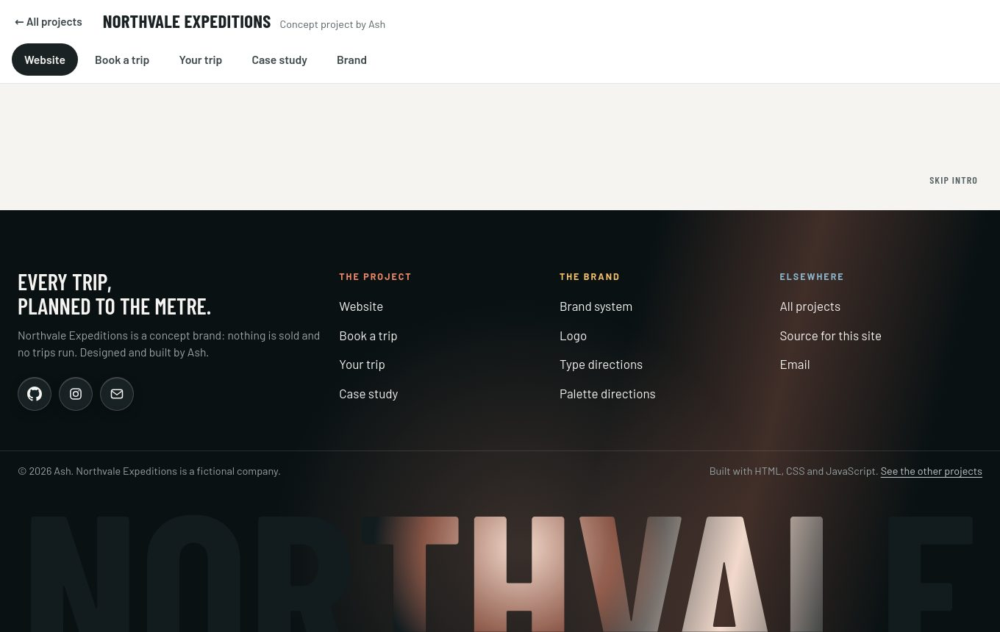

# Concept sites

**Websites and product UI, designed, built and tested.** Four concept brands, each with a landing page, a product screen and a case study. Static HTML, CSS and JavaScript, with automated tests on every page and a deploy that only runs when they pass.

**Live:** https://overseerdotpy.github.io/concept-sites/


> Every brand here is fictional, a company I invented to practice end-to-end product design. Nothing is sold and no real customer data appears anywhere.

## The work

| Project | Industry | What it is | Pages |
| --- | --- | --- | --- |
| **Northvale Expeditions** | Travel and outdoor | A guiding company: brand, website, booking flow and traveler's trip page, with a case study. All five parts open in [one tabbed page](site/northvale/index.html). | [Website](site/northvale/site/index.html), [booking](site/northvale/book/index.html), [trip page](site/northvale/trip/index.html), [case study](site/northvale/case-study/index.html), [brand](site/northvale/brand/system/index.html), [single file](site/northvale/standalone/index.html) |
| **Obsidra** | Cloud infrastructure | A GPU cloud that bills by the second. Brand identity, design system, product UI. | [Landing page](site/obsidra/index.html), [dashboard](site/obsidra/dashboard/index.html), [case study](site/obsidra/case-study/index.html) |
| **Amberline** | Fintech | Invoicing and cash flow for freelancers. Brand, logo, motion, landing page and app UI. | [Landing page](site/amberline/index.html), [app home](site/amberline/app/index.html), [logo guidelines](site/amberline/logo/index.html), [case study](site/amberline/case-study/index.html) |
| **TRAVL** | E-commerce | A 75% mechanical keyboard storefront with a configurator, cart and checkout. | Its own repository: [`travl-store`](https://github.com/Overseerdotpy/travl-store) |

| | |
| --- | --- |
|  |  |
|  |  |

The product screens are working prototypes, not pictures.

- **Northvale:** choose a departure on the website and the booking opens on that trip and date. Finish the booking and "Go to your trip" opens your own trip page with the same booking reference.
- **Obsidra dashboard:** choosing a GPU count shows the exact new price before you confirm (16 × $2.19 = $35.04/h), and the live meter keeps billing.
- **Amberline app:** filters add up to the full invoice list, a new invoice validates its amount, and marking an invoice paid moves exactly 25% of it into the tax pot.

## Run it

Requires Node 20 or newer.

```bash
npm install
npm start            # serves site/ at http://localhost:4173
```

### Tests

```bash
npx playwright install chrome   # once, or set CHROME_PATH to any Chrome
npm test                        # all tests
npm run report                  # open the HTML report
```

## What's tested

| Spec | What it proves |
| --- | --- |
| `pages` | Every page loads without errors, has a title, a description, a language and one `h1`; no private or dead placeholder links; every same-site link, image, script and stylesheet resolves; no horizontal scroll at 320, 390 and 1360px; reduced motion is respected; every page has a complete link preview whose image exists at 1200×630 |
| `a11y` | axe-core (WCAG 2.0/2.1 A and AA) finds no serious or critical issues on any page |
| `hub` | Thumbnails load and keep their shape, every card names its industry and has its summary, tags and links, the skip link works |
| `navigation` | Each hub link opens the right page, case studies link to their project's pages and back to the hub, disabled screens in the mockups do nothing |
| `northvale` | Tabs, keyboard use and deep links; each page keeps its state while you look at another; the website, booking and trip pages hand data to each other; a full booking from website to trip page; every page still works on its own; exactly one footer on the combined page, with the website's links carried over; the light beam footer: a slow shaft of light, a pointer glow, a wordmark cropped by the bottom edge, and stillness for reduced motion; behind the scenes: nothing is sent anywhere, the waitlist, seat limits, price and deposit maths, kit rental, card validation, and checklist progress saved per booking |
| `northvale-standalone` | The single file: self-contained (no outside scripts, no private links, no provenance data), the intro plays out and can be skipped, the tab bar by keyboard and with Back and Forward, one light beam footer on the four pages that end in one and none on the rest, every footer link (including links that cross pages), the beam and pointer glow, all the booking rules, nothing sent anywhere, saved trip progress, accessibility on every page, and no sideways scroll at four widths |
| `obsidra` | Live billing, Pause stops only the log feed, scaling price math for 4, 8, 16 and 32 GPUs, the stop dialog, keyboard access to the command lines |
| `amberline` | Filters partition the invoices, amount validation (malformed amounts rejected, normal formats accepted), sending and drafting invoices, the 25% tax-pot rule, reminders |

Several of the fixes below came straight out of this suite (the invoice amounts, the booking link that never carried the booking, the sideways scroll on phones, the stretched hub thumbnails). Their regression tests fail on the original code and pass on the fixed code.

## Measured quality

Lighthouse 13 in headless Chrome 131 on my machine, simulated throttling. Scores are performance on mobile and desktop, then accessibility.

| Page | Mobile | Desktop | Accessibility |
| --- | --- | --- | --- |
| Hub | 100 | 100 | 100 |
| Northvale combined page | 60 | 58 | 100 |
| Northvale single file (all seven pages in one HTML file) | 25 | 30 | 100 |
| Northvale website | 25 | 45 | 100 |
| Northvale booking | 91 | 97 | 100 |
| Northvale trip page | 65 | 96 | 100 |
| Northvale case study | 78 | 98 | 100 |
| Northvale brand pages (5) | 87 to 100 | 88 to 100 | 100 |
| Obsidra landing page | 98 | 100 | 100 |
| Obsidra dashboard | 100 | 99 | 100 |
| Obsidra case study | 99 | 100 | **96** |
| Amberline landing page | 98 | 100 | 100 |
| Amberline app | 94 | 92 | 100 |
| Amberline logo guidelines | 99 | 100 | 100 |
| Amberline case study | 98 | 100 | 100 |

Read these with five caveats:

- The **96** on the Obsidra case study is deliberate. Its contrast demonstration includes a white-on-violet button labelled "Fails WCAG AA", and the page shows why.
- Best practices scores 96 on most pages. The only failing audit is a console error from Google Fonts, which my offline test environment can't reach. I haven't measured it online.
- **The Northvale website is the weak spot.** It is a single 2.2 MB file with its photographs embedded, and it runs a WebGL scene. My test machine has no graphics card, so the scene is drawn in software and the main thread shows 19 seconds of blocking time, which a real phone or laptop would not. I don't trust that performance number, but the page weight is real and mobile loading is slower than it should be. Moving the photographs out into separate, compressed files is the next improvement.
- **The Northvale single file is heavy by design.** All seven pages are inside one 4.5 MB file, so a visitor downloads all of them before anything shows (mobile largest paint 23.7 s on a simulated slow connection). The multi-page version loads the landing page first. Use the single file when you need one portable file, and the multi-page version for visitors.
- Lighthouse reports a layout shift of 0.165 on the Amberline app, 0.239 on the Northvale logo animation page (it is a motion study) and 0.1 on the booking page at desktop size. A direct layout-shift observer sees none on the Amberline app, so I couldn't reproduce or fix it.
- axe-core can't judge everything. Colour contrast over gradients, images and animated states needs a human eye, and only serious and critical findings fail the build.

## What I changed from the original designs

I kept every visual decision and fixed what the audit found: low-contrast text, scrollable code lines a keyboard user couldn't reach, an invoice amount field that silently turned `-5` into $5.00, a "Go to your trip" link that was built before the booking existed, page-widening bugs on phones, and links that pointed at private pages. The complete list, with the reason for each, is in [`docs/CHANGES.md`](docs/CHANGES.md).

## How the Northvale page fits together

The five parts of Northvale were built to be shown together: the website, booking and trip pages already looked for a parent page and exchanged messages with it. The combined page at `site/northvale/` is that parent. It shows each part in a tab, loads a part the first time you open it, and passes the messages between them:

- the website says "open booking for this trip and date", and the booking page opens on it
- the booking page says "show this booking", and the trip page opens on it
- the case study's buttons switch tabs

Every part also works on its own, with ordinary links, so none of it depends on the combined page. Inside the combined page the parts hide their own footers, so there is a single footer. The footer is a re-creation, in plain HTML, CSS and JavaScript, of the 21st.dev "Light Beam Footer with Giant Wordmark" by Kedhareswer Naidu (MIT): a slow diagonal shaft of light and a pointer glow pass behind the link columns and through a giant wordmark cropped by the bottom edge, with glassy social buttons, accent-labelled link columns and a copyright row. I built it from the component's published description and did not have its source code, so no code was copied.

### Behind the scenes

Northvale has no server, and neither does the rest of this site: it is static files. The booking, waitlist, seat limits, pricing and saved checklist all run in the browser, and the tests prove they work and that nothing leaves it. A booking is not stored or emailed anywhere, nothing is charged (the payment step says so), and a trip's checklist progress is kept in the visitor's own browser, per booking. A real backend (stored bookings, confirmation emails) would need a service to host it, and a decision about collecting visitors' details.

### The single-file version

`site/northvale/standalone/index.html` is the whole Northvale project as **one HTML file**: a tab bar and seven pages (landing page, booking, your trip, case study, brand system, logo, logo animation) stored inside the file and opened in frames as you visit them. It works opened straight from disk, needs no server, and loads nothing from outside but fonts. It was added to this repository exactly as delivered, byte for byte, and the tests are written around the file; none of them edit it. The animated light beam footer ends the landing page, case study, brand system and logo pages.

## Project structure

```
site/                  everything that gets deployed
  index.html           the hub page
  assets/              thumbnails and link-preview images
  northvale/           combined page, plus site/, book/, trip/, case-study/, brand/
    standalone/        the whole project as one HTML file
  obsidra/             landing page, dashboard/, case-study/
  amberline/           landing page, app/, logo/, case-study/
  vendor/              html2canvas and GSAP, self-hosted
tests/                 Playwright specs
scripts/lighthouse.mjs Lighthouse for every page
docs/                  CHANGES.md and screenshots
.github/workflows/     CI: test, informational Lighthouse, GitHub Pages deploy
```

There's no build step. `site/` is deployed as it is.

## Deploying to GitHub Pages

1. Push to a repository named `concept-sites` on the `main` branch.
2. In **Settings, Pages**, set **Source** to **GitHub Actions**.
3. The workflow tests every page and then deploys `site/`. A failing test blocks the deploy.

## Roadmap

1. Move the Northvale website's photographs out of the HTML into compressed files.
2. More projects in the same pattern (Strata, Postwright).
3. Self-host the fonts.
4. Rename the Obsidra dashboard's "Pause" so it can't read as pausing billing.

## License

Code: MIT (see `LICENSE`). Brand names, logos and imagery are not licensed for reuse; see [`NOTICE.md`](NOTICE.md).
