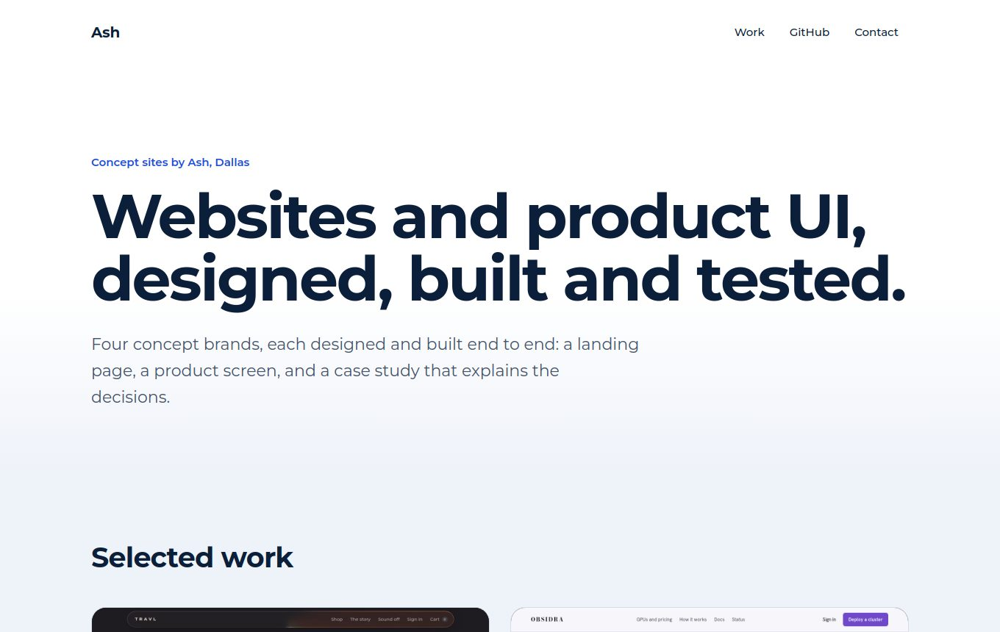
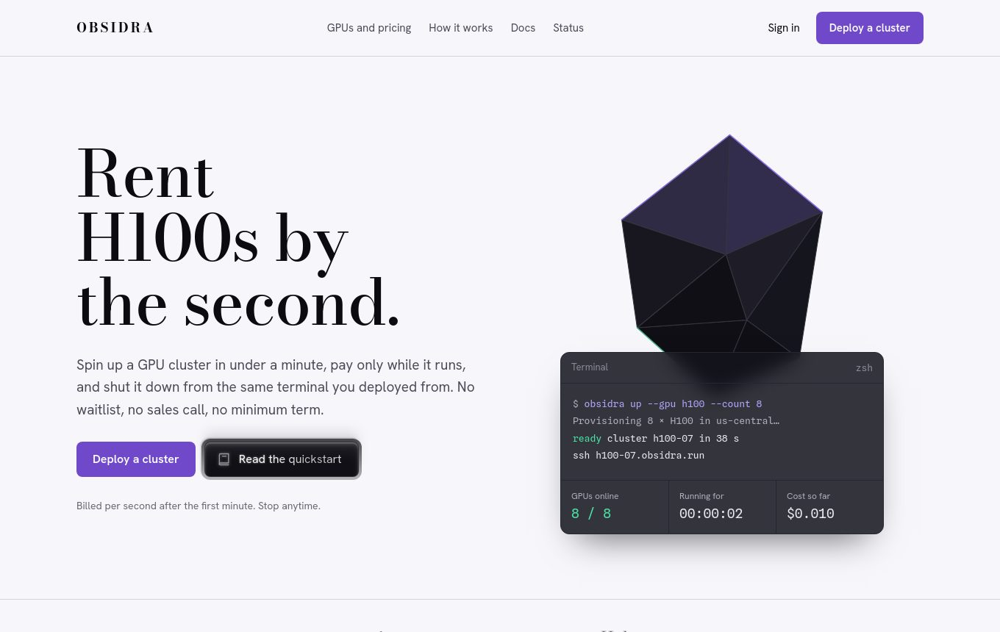
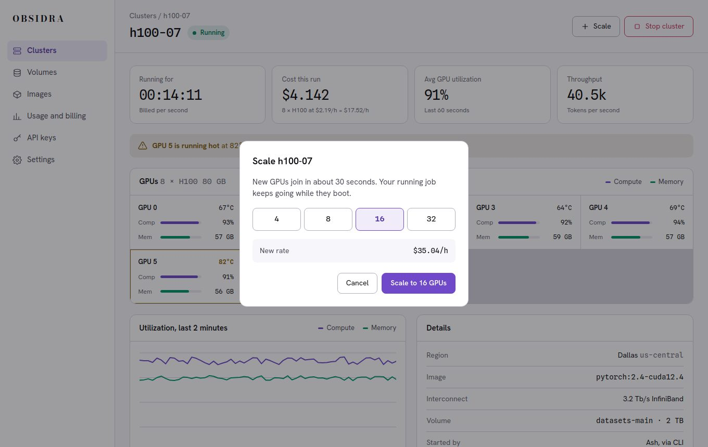
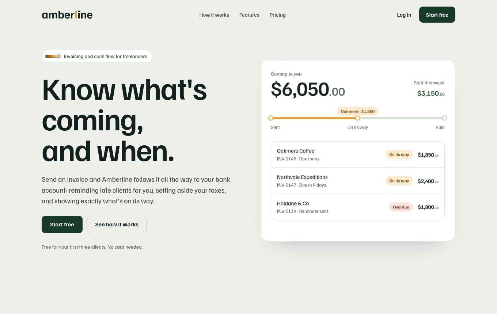
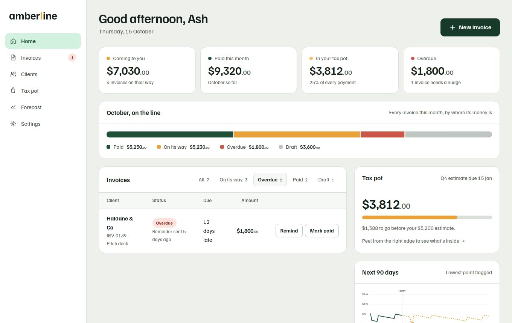

# Concept sites

**Web and UI design for hardware and deep-tech brands.** Concept sites designed and built end to end, each with a landing page, a product screen and a case study. Static HTML, CSS and JavaScript, with 95 automated tests and a deploy that only runs when they pass.

**Live:** `https://Overseerdotpy.github.io/concept-sites/`



> Every brand here is fictional, a company I invented to practice end-to-end product design. Nothing is sold and no real customer data appears anywhere.

## The work

| Project | What it is | Pages |
| --- | --- | --- |
| **Obsidra** | A GPU cloud that bills by the second. Brand identity, design system, product UI. | [Landing page](site/obsidra/index.html), [dashboard](site/obsidra/dashboard/index.html), [case study](site/obsidra/case-study/index.html) |
| **Amberline** | Invoicing and cash flow for freelancers. Brand, logo, motion, landing page and app UI. | [Landing page](site/amberline/index.html), [app home](site/amberline/app/index.html), [logo guidelines](site/amberline/logo/index.html), [case study](site/amberline/case-study/index.html) |
| **TRAVL** | A 75% mechanical keyboard storefront with a configurator, cart and checkout. | Its own repository: [`travl-store`](https://github.com/Overseerdotpy/travl-store) |

| | |
| --- | --- |
|  |  |
|  |  |

The two app mockups are working prototypes, not pictures. In the Obsidra dashboard, choosing a GPU count shows the exact new price before you confirm (16 × $2.19 = $35.04/h), and the live meter keeps billing. In the Amberline app, filters add up to the full invoice list, a new invoice validates its amount, and marking an invoice paid moves exactly 25% of it into the tax pot.

## Run it

Requires Node 20 or newer.

```bash
npm install
npm start            # serves site/ at http://localhost:4173
```

### Tests

```bash
npx playwright install chrome   # once, or set CHROME_PATH to any Chrome
npm test                        # all 95 tests
npm run report                  # open the HTML report
```

## What's tested

| Spec | What it proves |
| --- | --- |
| `pages` | Every page loads without errors, has a title, a description, a language and one `h1`; no private or dead placeholder links; every same-site link, image, script and stylesheet resolves; no horizontal scroll at 320, 390 and 1360px; reduced motion is respected |
| `a11y` | axe-core (WCAG 2.0/2.1 A and AA) finds no serious or critical issues on any page |
| `hub` | Thumbnails load and keep their shape, every card has its summary, tags and links, the skip link works |
| `navigation` | Each hub link opens the right page, case studies link to their project's pages and back to the hub, disabled screens in the mockups do nothing |
| `obsidra` | Live billing, Pause stops only the log feed, scaling price math for 4, 8, 16 and 32 GPUs, the stop dialog, keyboard access to the command lines |
| `amberline` | Filters partition the invoices, amount validation (malformed amounts rejected, normal formats accepted), sending and drafting invoices, the 25% tax-pot rule, reminders |

Several of the fixes below came straight out of this suite (the invoice amounts, the sideways scroll on phones, the stretched hub thumbnails). Their regression tests fail on the original code and pass on the fixed code.

## Measured quality

Lighthouse 13 in headless Chrome 131 on my machine, simulated throttling:

| Page | Mobile perf | Desktop perf | Accessibility | SEO |
| --- | --- | --- | --- | --- |
| Hub | 100 | 100 | 100 | 100 |
| Obsidra landing | 98 | 100 | 100 | 100 |
| Obsidra dashboard | 100 | 99 | 100 | 100 |
| Obsidra case study | 99 | 100 | **96** | 100 |
| Amberline landing | 98 | 100 | 100 | 100 |
| Amberline app | 94 | 92 | 100 | 100 |
| Amberline logo guidelines | 99 | 100 | 100 | 100 |
| Amberline case study | 98 | 100 | 100 | 100 |

Read these with three caveats:

- The **96** on the Obsidra case study is deliberate. Its contrast demonstration includes a white-on-violet button labelled "Fails WCAG AA", and the page shows why.
- Best practices scores 96 on every page. The only failing audit is a console error from Google Fonts, which my offline test environment can't reach. I haven't measured it online.
- Lighthouse reports a layout shift of 0.165 on the Amberline app (and 0.071 on the Obsidra dashboard) at desktop size. A direct layout-shift observer sees none on either page, so I couldn't reproduce or fix it.

axe-core can't judge everything. Colour contrast over gradients, images and animated states needs a human eye, and only serious and critical findings fail the build.

## What I changed from the original designs

I kept every visual decision and fixed what the audit found: low-contrast text, scrollable code lines a keyboard user couldn't reach, an invoice amount field that silently turned `-5` into $5.00, a page-widening bug in the Amberline app, and links that pointed at private pages. The complete list, with the reason for each, is in [`docs/CHANGES.md`](docs/CHANGES.md).

## Project structure

```
site/                  everything that gets deployed
  index.html           the hub page
  assets/thumbs/       project thumbnails
  obsidra/             landing page, dashboard/, case-study/
  amberline/           landing page, app/, logo/, case-study/
  vendor/              html2canvas, self-hosted
tests/                 Playwright specs
scripts/lighthouse.mjs Lighthouse for every page
docs/                  CHANGES.md and screenshots
.github/workflows/     CI: test, informational Lighthouse, GitHub Pages deploy
```

There's no build step. `site/` is deployed as it is.

## Deploying to GitHub Pages

1. Push to a repository named `concept-sites` on the `main` branch.
2. In **Settings, Pages**, set **Source** to **GitHub Actions**.
3. The workflow tests every page and then deploys `site/`. A failing test blocks the deploy.

## Roadmap

1. More projects in the same pattern (Strata, Northvale Expeditions, Postwright).
2. Self-host the fonts.
3. Rename the Obsidra dashboard's "Pause" so it can't read as pausing billing.

## License

Code: MIT (see `LICENSE`). Brand names, logos and imagery are not licensed for reuse; see [`NOTICE.md`](NOTICE.md).
